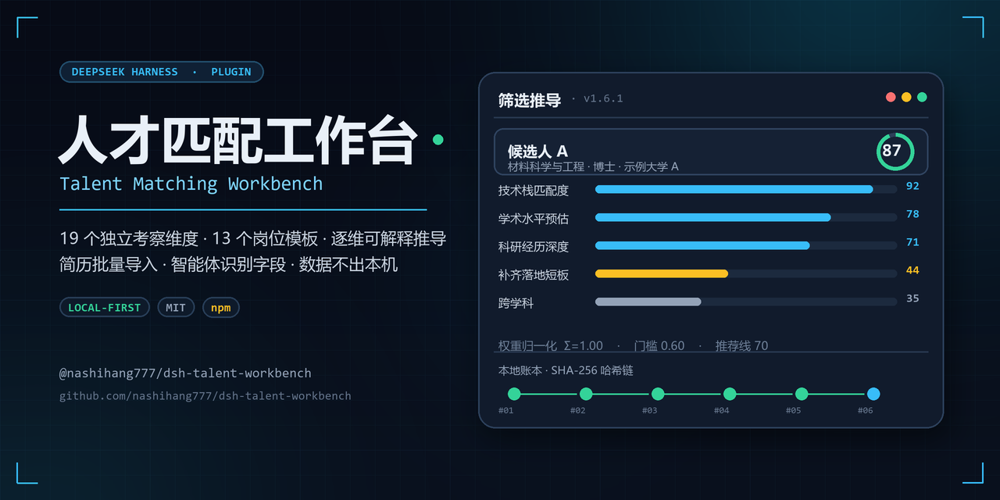

# Talent Matching Workbench (`@nashihang777/dsh-talent-workbench`)

[](https://github.com/topics/dsh-plugin)
[](https://www.npmjs.com/package/@nashihang777/dsh-talent-workbench)
[](LICENSE)
[](README.en.md#local-data-and-privacy)

[简体中文](README.md) · **English** · [GitHub](https://github.com/nashihang777/dsh-talent-workbench) · [Gitee](https://gitee.com/shijiehanghai/dsh-talent-workbench) · [npm](https://www.npmjs.com/package/@nashihang777/dsh-talent-workbench) · [Releasing](RELEASING.md)



> **A DeepSeek Harness plugin** that turns resume screening into an explainable, weight-adjustable, local-first flow: one icon in the left rail opens a full-page workbench with 19 independent dimensions, 13 role templates, per-dimension derivation, batch import with agent-read fields, and an anonymous exchange ledger.

Candidate data is written only to a local JSON database. Text extraction and OCR happen entirely on your machine; only field recognition sends the **plain text already extracted** to the model you configured, and it can be switched off.

## Install in DeepSeek Harness (Windows)

1. Open the **DeepSeek Harness** desktop app.
2. Click **“Plugins”** in the left sidebar.
3. Click **“Add plugin”** in the top-right corner.
4. Enter the package name **`@nashihang777/dsh-talent-workbench`**.
5. Click **“Install”** and wait for it to finish.
6. **Refresh the page**: a **“Talent”** icon appears in the left rail; click it to open the full-page workbench.

> You can check the version first on npm: <https://www.npmjs.com/package/@nashihang777/dsh-talent-workbench>.
> On first open the plugin ships 22 **fictional** candidates purely as a UI preview. They are never written to the database and disappear as soon as one real candidate is imported or added.

### Other ways to install

```bash
# install from the command line
dsh plugin install @nashihang777/dsh-talent-workbench

# develop against this repository directly (changes take effect without a release)
git clone https://github.com/nashihang777/dsh-talent-workbench.git
# link the directory into your profile, or give “Plugins → Add plugin” the absolute path
```

Versioning and publishing conventions are in [RELEASING.md](RELEASING.md); tagging the repo with the `dsh-plugin` topic, uploading the social preview and cutting a GitHub Release are covered in [docs/PUBLISHING.md](docs/PUBLISHING.md).

## What it solves

Typical role screening relies on one fixed scoring sheet: every dimension has a level, a hit count, and two rule sets (A/B). The problem is visible: **dimension weights are never managed explicitly**, so dimensions such as “cross-disciplinary” or “covers the deployment gap” systematically push the result toward mechanical/control majors; and a different role should use a different set of dimensions.

The plugin splits the flow into three parts:

1. **Role templates** — pick dimensions from the skill library, give each a relative weight, an optional gate, and recommend/backup thresholds. Weights are relative and normalised automatically.
2. **Dimension skills** — 19 independent, versioned assessment standards. The first 8 target research roles (tech-stack fit, cross-discipline, academic level, deployment gap, theory depth, long-term potential, research depth, research focus); the other 11 target general role families in internet/manufacturing/healthcare/finance (engineering quality, system design, data and experimentation, modelling and tuning, product sense, domain knowledge, collaboration, outcome delivery, learning agility, field implementation, compliance and risk). Each standard documents the goal, method, evidence checklist, grading scale, anti-bias notes, interview follow-ups and output format; all of them are also registered as DSH skills the agent can load.
3. **Explainable derivation** — for every candidate × template pair, each dimension shows “evidence → level → score × weight → contribution”, plus the legacy (hit-count) rank, failed gates, major concentration, and how ranks shift under weight perturbation.

## Role families and templates (based on public job postings)

Templates are based on publicly advertised job titles and requirements — only the shared assessment points are extracted; no job text, company name or personal information is copied:

| Template | Reference job types | Main dimensions |
|---|---|---|
| AI + rare-earth research (calibrated / legacy comparison) | research-team hiring | tech stack, academic level, theory depth, research depth |
| AI algorithm engineer (speech/vision/NLP) | speech algorithm expert, vision/NLP engineer | modelling, engineering quality, data and experiments |
| Backend engineer (Node/Java/Go) | Node.js developer, backend developer | engineering quality, system design, delivery pace |
| Data engineer / data analyst | data development, data platform | data and experiments, engineering quality, modelling |
| Data analyst (business analysis) | data analyst, business analysis | data and experiments, product sense, delivery |
| Quantitative researcher | quant researcher, options quant | modelling, data and experiments, compliance |
| B2B product manager (industrial/energy software) | smart-plant PM, product architect | product sense, domain knowledge, field implementation |
| Implementation / operations project manager | application operations PM, implementation consultant | field implementation, collaboration, delivery pace |
| Medical device / lab medicine | lab medicine specialist, device R&D/quality | domain knowledge, compliance (hard gate) |
| Smart manufacturing / production support | production support, QA on site, mechanical product planning | field implementation, domain knowledge, engineering quality |
| Internal control / risk | internal control, risk management | compliance (hard gate), domain knowledge, collaboration |
| Key-account sales / business development | business sales, media BD, solution sales | outcome delivery, customer-facing work, collaboration |

**Industry focus keywords**: every industry template can declare target-industry keywords (e.g. “medical device”, “quantitative finance”). The “domain knowledge and industry experience” dimension aligns to that industry: when the resume contains none of the keywords, that dimension is capped at 0.4 and the derivation is annotated “industry mismatch”. This keeps a generic resume with a high generic domain score from occupying the recommendation slot of an unrelated industry. Keywords are editable in the template editor; leave them empty to skip the check.

**What the recommend line means**: different role families combine different dimensions, so their attainable totals differ (a medical-device template has a hard gate and narrower dimensions, hence a lower ceiling than a backend template). The recommend/backup lines are set **relative to that role family**; after switching templates, re-check them against your actual candidate pool instead of reusing one template’s thresholds on another.

## Recruiting tasks, interview batches and feedback (since v1.7)

**No task, no candidates.** Every resume hangs off a “recruiting task → interview batch” tree, and resumes in different batches are never compared with each other.

### Three steps

1. **Create the recruiting task** — one role per task (e.g. “Algorithm engineer · 2026 spring”), and pick an initial template for it;
2. **Upload resumes** — “Import resumes” and “Add candidate” both write into the current batch of the current task;
3. **Split into batches** — on the “Batches & feedback” page create a batch with its interview dates (the same day, or two or three close days) and assign resumes to it.

**A recruiting task is the only way into the screening flow**: the header has a permanent “Create task” button and the “Batches & feedback” page lists every task with its own create button; importing without a task is refused instead of quietly dropping everything into a default bucket.

Each task owns its template, batches and candidates. If historical data sits in one task, create a new task and tick “Also show candidates from other tasks” in the assign block to re-file them into the new task's batches.

When no task exists yet the UI is blocked by “create a recruiting task first” — deliberately, so different roles and different interview sessions never end up in one ranking.

### Suggested batches from interview dates

Candidates carry an “interview date”. “Suggest from interview dates” groups resumes whose interviews are no more than two days apart (configurable) and proposes batches; you decide whether to take them — create one batch per group, or rename and edit the dates by hand.

### Comparing inside a batch

The “Screening” view has a row of batch chips: pick one and everything — ranking, recommendation list, bias diagnostics — is computed inside that batch only, with ranks restarting at 1. Switching task or batch switches the working set immediately.

### Feedback → template adjustment

- Record feedback on **one resume**, **one batch** or **the whole task** (agree / disagree / needs adjusting / note) with a concrete reason;
- once you have a few, click “Ask the agent to adjust”: the model reads them together with the current template weights and returns a **preview** (which dimension moves from what to what, what is added or removed, and why);
- confirm with “Apply as a new version” to create a new template version; old versions stay rollback-able and applied feedback is marked so it does not count twice.

Adjustments are bounded, vague feedback produces no change, and the model cannot invent dimensions — it can only reweight existing ones or add from the skill library.

### Agent side

`talent_screening` gained `list_tasks`, `create_task`, `assign_batch`, `add_feedback` and `review_feedback`. The agent can create tasks, split batches, record feedback, and apply the template adjustment once you confirm (`review_feedback` without `apply` is a preview).

### Upgrading

Candidates from 1.6 are adopted into a “默认招聘任务 / 历史导入” (default task / historical import) batch on first load — nothing is lost, and you can rename, split or archive it.

## Adding candidates: manual entry and resume import

Both paths coexist; the entry points sit in the panel header and in the “Screening” toolbar:

1. **Manual entry** (`Add candidate`): fill the fields one by one; structured evidence (publications, projects, engineering delivery, theory, roles) is maintained in collapsible groups; saving runs a rule-based first pass immediately.
2. **Resume import** (`Import resumes`):
   - Choose **multiple files** or an **entire folder** (browser folder picker, subdirectories included), or give a local absolute path for the host side to read (also usable by the agent).
   - Supported formats: `.pdf`, `.doc`, `.docx`, `.rtf`, `.txt`, `.md`, and `.png/.jpg/.jpeg/.webp/.bmp/.tif/.tiff`.
   - Parsing: DOCX is read directly from OOXML; DOC reads the piece table of a Word 97-2003 compound file; PDF first tries the text layer and falls back to per-page rasterisation plus OCR; images go straight to OCR.
   - Before importing, each file gets **editable suggested fields** (alias/name, major, degree, school, direction) and an **extracted-text preview**; OCR results are marked “needs review” and keep page-image paths so `read_image` can verify them.
   - Multi-page scans of one candidate are **merged by file name**: `example-c.jpg`, `example-c (page 1).jpg`, `example-c (page 2).jpg` collapse into one row, ordered by “page N” or a trailing number.
   - Identical resumes are flagged “likely duplicate” (within the batch and against the local database) and skipped on commit, so nothing is imported twice.
   - Nothing is stored until you commit; temporary files and page images are removed after commit or discard.

### Parsing runs in the background (since v1.6.0)

After you pick files or a folder, parsing runs on the host side and the frontend only displays progress:

- `resumes.startScan` **returns immediately** with a `jobId`; the frontend polls `resumes.job` every 0.9 s;
- progress has two phases: `Extracting text (3/7)` → `Agent reading fields (4/7)`, with a progress bar and the list of files already extracted;
- **closing the import dialog does not interrupt it**: the job belongs to the page, not the dialog, so the progress bar stays in the page header and “View progress / Review result” brings the list back;
- switching tabs or returning to the conversation behaves the same;
- a page reload also recovers: on load the frontend calls `resumes.jobs` and reattaches to a running job, or restores the most recent finished-but-unimported result;
- `Cancel task` stops it (temporary files are cleaned immediately); `Choose again` discards the current result.

Finished jobs live in the host’s in-memory job table (at most 6). Temporary files are deleted only when a job is discarded or an import is committed.

### Fields are read by the agent (since v1.5.0)

After picking files or a folder, **text extraction still happens locally** (DOCX/DOC, PDF text layer, OCR for scans), but **name, major, degree, school, direction and the structured evidence (publications/projects/engineering/theory/roles/awards) are produced by the agent reading that text** instead of regexes. The reason is simple: a regex cannot tell “the research field mentions materials” from “a materials-major PhD”, nor whether “Education” is a section heading or a person’s name.

- Which model: your DSH default model by default (`import.agentProvider` / `import.agentModel` override it);
- Batching: 3 resumes per request (`import.agentBatch`), up to 9000 characters per resume (`import.agentMaxCharsPerResume`), 90 s timeout per call;
- A whitelist normalisation still runs afterwards: degrees must be “PhD / Master / Bachelor”, and invalid enum values for author position or project role are dropped or downgraded — a field the model has no evidence for stays empty;
- Every row carries an `Agent parsed` / `Rule parsed` badge, and the summary shows `Agent parsed N/M`;
- **Failure falls back**: if the model is unavailable, times out, or returns unparseable output, the local regex path runs and the row is annotated “agent parsing failed, fell back to local rules” with the reason;
- **Switching it off**: `import.useAgent: false` uses local rules only.

> Privacy boundary: this is the only step in the import flow that leaves the machine — it sends the **already extracted plain text** to the model you configured. No files, no images, no third-party service. Disable `useAgent` and nothing goes online.

### Local-rule fallback (when the model is unavailable)

When the model returns nothing, rules take over, also keyed on the highest degree.

**The major comes from the final degree.** Each education record is parsed first, and the major is taken from the record with the highest degree; dates, school, advisor and degree words are stripped from that record so only the field of study remains:

```
        dates          degree   school                major                 advisor
2018.09-2022.06        PhD      Example City, Example University   Software Engineering   Prof. Example   → Software Engineering
2015.09-2018.06        Master   Example City, Example University   Computer Science       Prof. Example
```

Decision order:

1. **The education record with the highest degree** (two shapes are recognised):
   - a row with a date range or a school: `2018.09-2022.06 PhD … Software Engineering … Prof. Example`;
   - a header line pairing the field with the degree: `Materials Science and Engineering | PhD in Engineering`.
2. An explicit field: `Major: …`, `Discipline: …`;
3. The file name, when the recruiter curated it: `401_Mathematics_Example-A.pdf`;
4. Only then the first 400 characters of the header.

Two guards against misreads:

- **Labelled lines are not education records**: lines starting with `Research area / Research direction / Projects / Job objective / Skills / Publications / Awards …` are skipped. This is exactly why a candidate used to be classified as “artificial intelligence” — their `Research area: … generative AI` line came before the education table.
- **Weak words only count in trusted contexts**: short majors that are also ordinary words (`Materials`, `Chemistry`, `Physics`, `Mathematics`, `Mechanics`) are only accepted from education records, explicit fields and file names; loose mentions in the body are ignored, and the “chemistry” inside `machine learning` is masked.

**School** comes from the highest-degree record, preferring the university over one of its colleges (`Example University, School of Materials` → Example University); a city-prefixed form such as `Example City, Example University` also resolves correctly.

**Degree** likewise follows the highest education record (`Bachelor → Bachelor's`).

**Multi-person documents**: if a file is really a list, a review memo or a table (3+ numbered entries, or 3+ `Name:` labels, or 2 name labels plus 4+ degree words), the import marks it “possibly multiple people”, **leaves it unselected by default**, and skips it on commit. Such files are not suitable as a single resume record.

**Correcting existing records**: the “Data & backup” page has two buttons:

- `Re-check with the agent` (recommended): hands the stored resume text back to the model, fixes name/major/degree/school/direction, and backfills publications, projects and engineering evidence when those were empty; preview first, then apply — applying re-runs the rule pass and writes an audit entry. Multi-person files are skipped. Agent-side: `talent_screening action=agent_refresh_fields` (omit `apply` to preview).
- `Verify imported fields` (offline): recomputes with local rules only and spends no model quota. Agent-side: `action=refresh_import_fields`.

Names are only overwritten by the model for rule-parsed records (rules often read `Education` or `Applicant` as a person); records already parsed by the model are never renamed again, so manual corrections are not undone.

For imported candidates `profileText` holds the full extracted resume and `sourceFile` / `extraction` record the file and engine; structured evidence (publications/projects/engineering/theory/roles/awards) is extracted by the agent during import and is empty when the model had nothing to add — fill it in on the candidate and re-run the evaluation.

OCR notes: the plugin uses the built-in `Windows.Media.Ocr` engine (Chinese `zh-Hans-CN`, English `en-US`). Quality on Chinese resumes is usable but the engine inserts spaces between characters and occasionally confuses similar glyphs — the plugin cleans spaces and fixes common errors, yet **critical fields must be reviewed by a human**. PDF rasterisation needs poppler’s `pdftoppm` / `pdftotext` (shipped with TeX Live, MiKTeX or a standalone poppler); without them, scanned PDFs cannot be OCRed and the UI says so explicitly. DOC/DOCX parsing works without Word or LibreOffice installed.

## Opening the workbench

The entry point is in the **global left rail** (next to “Plugins” and “Schedules”):

- click the **Talent** icon (a list-plus-sidebar glyph) and the main area switches to the full-page workbench;
- it is no longer a button next to the composer and does not occupy the right sidebar; click the conversation icon to go back;
- the page opens on “Overview”, which explains how templates, drafts and derivation relate.

## Interface structure

A full-page layout whose width follows the main area (comfortable for 19 dimensions, 13 templates and per-dimension derivation):

- **Header**: title, local/privacy badges, current template selector, `Import resumes` (tinted) and `Add candidate` (solid primary);
- **Tabs**: Overview / Screening / Role templates / Dimension skills / Anonymous exchange / Data & backup, each with a count;
- **Screening**: candidates on the left, per-dimension evidence in the middle, decision score and thresholds on the right (three columns on wide screens; narrow screens stack and show the score card first);
- **Button hierarchy** has four levels: solid primary = the page’s main action, tinted = secondary but frequent, outlined = ordinary, ghost/red = low-weight or destructive.

## Drafts and the current template

- Adjusting weights under “Role templates” immediately recomputes “Screening” from the draft and shows an `Unsaved draft` marker; switching templates asks whether to discard it.
- The draft is written to the local database only after “Save as new version”; a newly created template becomes the current one once saved.
- “Set as current” decides which saved template screening uses; the current one is marked in the list.

## Local data and privacy

- Data directory: `$DSH_PROFILE_DIR/talent-workbench/` (default `~/.dsh/profiles/<profile>/talent-workbench/`) with `db.json`, `db.backup.json` and `instance.json`.
- Candidate names, resume text, contact details, evidence, evaluations and template/skill versions are written only to this local directory. The panel calls only the same-origin endpoints of your local DSH service (`/dsh-talent/api`, loopback only) and sends nothing to external networks.
- **Anonymous exchange packs** may contain only: dimension means, level shares, normalised weights, sample-size buckets, role family, an anonymous instance id, and an integrity hash. On import the plugin enforces a field allowlist, scans for privacy features (email/phone/national id/URL/long digit runs/overlong free text) and verifies a SHA-256 digest.
- With fewer than 5 candidates the export warns that means are close to a personal profile and suggests accumulating samples first.
- The local ledger is a SHA-256 hash chain for tamper evidence and rollback. It is a **local prototype** of the collaborative-evolution mechanism: no public chain, no automatic networking. Exchanges happen through manual `.json` export/import.
- Full backups contain personal data and should stay on your machine; the UI says so explicitly.

## Versions and rollback

- Each template save creates a new version; each skill edit creates a new version; both are rollback-able (a rollback itself creates a new version and never overwrites history).
- Version history shows the weights of every version, so you can compare before rolling back.
- Each “Generate screening snapshot” records the template version, skill versions, weights, per-candidate results and major distribution at that moment.
- The audit log keeps the 200 most recent local operations.

## Agent tool

The `talent_screening` tool exposes:

`overview`, `list_tasks`, `create_task`, `list_candidates`, `evaluate`, `import_candidate`, `scan_resumes`, `import_resumes`, `refresh_import_fields`, `agent_refresh_fields`, `set_assessment`, `assign_batch`, `add_feedback`, `review_feedback`, `preview_pack`, `export_pack`, `import_pack`, `verify_chain`.

Example flow:

```
talent_screening action=scan_resumes path="D:\\resumes\\batch-3" recursive=true
talent_screening action=scan_resumes path="D:\\resumes\\example-a.pdf"
talent_screening action=import_resumes scanId=<id> keys=["item-1","item-2"]
```

`scan_resumes` only parses and stores nothing; `import_resumes` can override alias/major/degree/school/direction per item and skips resumes whose content is identical. OCR items report their page-image paths so `read_image` can verify them before you commit.

Registered dimension skill names:

`talent-dimension-tech-stack`, `talent-dimension-cross-discipline`, `talent-dimension-academic-level`, `talent-dimension-engineering-gap`, `talent-dimension-theory-depth`, `talent-dimension-long-term-potential`, `talent-dimension-research-depth`, `talent-dimension-research-focus`, `talent-dimension-engineering-quality`, `talent-dimension-system-design`, `talent-dimension-data-experiment`, `talent-dimension-modeling-tuning`, `talent-dimension-product-sense`, `talent-dimension-domain-knowledge`, `talent-dimension-collaboration`, `talent-dimension-outcome-delivery`, `talent-dimension-learning-agility`, `talent-dimension-field-implementation`, `talent-dimension-compliance-risk`.

## Sample data (frontend only, never stored)

22 **fictional** candidates (14 research + 8 across internet/manufacturing/healthcare/finance) ship inside `client.js` and are used **only as a first-run UI preview**:

- they are **never written to the database**; `buildSeedDb()` keeps the candidate table empty and an upgrade also deletes sample rows stored by older versions (recorded in the audit as `data.purgeSamples`);
- as soon as one real candidate exists (imported or added manually) the samples disappear; clearing every candidate brings them back for another demo;
- sample candidates are **read-only** in the UI: they cannot be edited, re-levelled, snapshotted or reported; the toolbar shows a `Sample preview` badge and an explanatory banner;
- their levels are precomputed with the same rule engine at build time, and `dev/industry-smoke.mjs` compares the embedded values with the engine’s current output so the two cannot drift.

The 13 templates and 19 dimension skills are real content: they are written to the database and keep version history.

The two research templates are deliberately contrasted: the legacy one weights “cross-discipline” and “covers the deployment gap” high, which fills the recommendation list with mechanical/control backgrounds and is called out by the bias diagnostics; the calibrated one lowers those two and raises tech-stack fit and academic level, producing a more spread-out list. This is an exercise in “change weights → read diagnostics → change again”, not the single right answer.

Each of the 11 industry templates ranks its own fictional matching candidate first (`dev/industry-smoke.mjs` asserts this), demonstrating that the same pool orders completely differently under different role templates.

## Known limitations

- Exchange is a local hash chain plus manual file exchange: no public chain, no consensus, incentive or sybil resistance. Cross-organisation collaboration needs an additional trust and identity layer.
- Sample candidates are not stored, so the agent-facing `talent_screening` tool never sees them; the agent only handles real candidates.
- The rule-based first pass is a deterministic heuristic, not a substitute for interviews and human judgement; the UI labels “rule pass / human review” explicitly.
- Dimension skills are domain standards, not legal advice; hiring decisions must still comply with local labour law and anti-discrimination requirements.
- The panel depends on the `webServer` route of the current web profile; in a runtime without that service the tool still works but the panel cannot read local data.
- The interface is primarily Chinese; English covers the main navigation and key messages, while the skill bodies are Chinese domain content.
- The 11 added dimensions are **keyword/structure heuristics** (e.g. hits on “unit test”, “CI”, “A/B test”, “live trading” add points) and only provide a starting level; the UI lists the matched keywords and the interviews must confirm them using the questions in each skill.
- Recommend lines for industry templates are relative to that role family; totals from different templates are not directly comparable — re-check thresholds after switching.
- Resume import: OCR can contain typos and must be reviewed; multi-page TIFF only reads the first page; scanned PDFs OCR the first 6 pages by default (`import.maxOcrPages`); tables, two-column layouts and formulas are easily misread; encrypted PDF/DOC fails with an explanation.
- Multi-page merging relies on file names: suffixes like `(page N)`, `_p2`, `-2` are stripped before grouping; if pages are named inconsistently, select them manually or import in two passes.
- One batch is limited to 40 files / 40 MB (configurable); larger batches take longer to OCR and the UI shows elapsed time — keep the window open while parsing (temporary files are cleaned after parsing finishes either way).
- Turning a resume into structured evidence (author position, project role, engineering delivery) is still heuristic and only feeds the dimension first pass; verify the key judgements in interviews using the questions in each dimension skill.

## Configuration

Override the plugin row in `cordis.patch.yml`:

```yaml
- id: talent-workbench
  name: '@nashihang777/dsh-talent-workbench'
  config:
    dataDir: ''                 # empty = $DSH_PROFILE_DIR/talent-workbench
    autoRegisterSkills: true
    allowRealNames: false       # true allows real names in the UI
    import:
      maxFiles: 40              # files per scan
      maxBytes: 50331648        # bytes per upload batch (48 MB)
      useAgent: true            # field recognition via the agent; false = local rules only
      agentProvider: ''         # empty = follow the DSH default model
      agentModel: ''
      agentBatch: 3             # resumes per model request
      agentTimeoutMs: 90000
      agentMaxCharsPerResume: 9000
      maxOcrPages: 6            # pages OCRed for a scanned PDF
      ocrScaleTo: 2400          # longest edge in pixels after rasterising (scans often claim huge sizes; capping pixels is what keeps it fast)
      ocrLanguage: 'zh-Hans-CN'
      poppler:
        pdftotextPath: ''       # empty = search PATH and common install dirs
        pdftoppmPath: ''
```

## Development

- `index.js`: host entry, local API, skill registration, the `talent_screening` tool.
- `lib/`: seed data, scoring engine, local store, anonymous exchange, agent field extraction, workbench service.
- `lib/import/`: resume parsing (`extract.js` dispatches, `zip.js` reads DOCX, `ole.js` reads DOC, `pdf.js` drives poppler, `ocr.js` + `windows-ocr.ps1` drive Windows OCR).
- `client.js`: the full-page workbench panel (React, no third-party dependencies).
- `skills/`: 19 copies of the `SKILL.md` standards; at runtime the database version wins.
- `docs/`: plugin detail page and preview image.
- `dev/`: local self-check scripts (not published to npm). `node dev/smoke.mjs` verifies the service and exchange; `node dev/industry-smoke.mjs` verifies that each of the 11 industry templates ranks its matching candidate first, that the industry keyword cap applies, and that an old database upgrade only adds new content; `node dev/import-smoke.mjs` generates DOCX/TXT fixtures and verifies parsing and import; `node dev/render-smoke.mjs` renders every UI branch with a stub React; `node dev/background-smoke.mjs` verifies that a background import job survives closing the dialog and that its result can be rebuilt.

## Contributing and credits

- Issues and pull requests go through GitHub: <https://github.com/nashihang777/dsh-talent-workbench/issues>;
- the release flow (npm Trusted Publishing) is in [RELEASING.md](RELEASING.md);
- this plugin is not affiliated with any recruiting platform; templates only distil assessment points from public job postings.

## License

[MIT](LICENSE)
